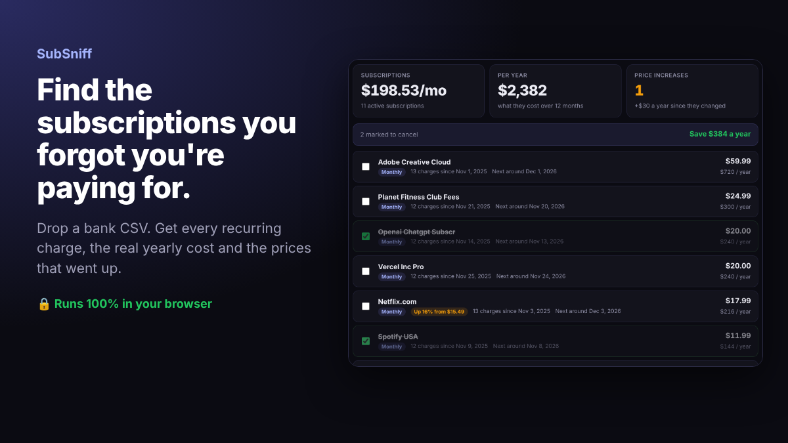

# SubSniff

**Find the subscriptions you forgot you're paying for.**

Drop a CSV export from your bank or card. SubSniff finds every recurring charge, shows what it really costs per year, flags prices that went up, and lets you tick what to cancel to see how much you save.

**[Try it live](https://lockdomain.github.io/subsniff/)** (there is a sample statement if you just want to look)



## Private by design

Bank statements are about as personal as data gets. SubSniff is three static files. Your CSV is read with `FileReader` inside the tab and never sent anywhere. No accounts, no analytics, no server.

## What it does

* Finds weekly, every two weeks, monthly, quarterly and yearly charges
* Groups messy merchant names (`NETFLIX.COM 866-579-7172 CA`, `PAYPAL *SPOTIFY`) into one subscription
* Splits one merchant into price bands, so your $9.99 plan is not mixed with random purchases
* Flags price increases since the first charge
* Separates subscriptions from bills like rent and insurance, and shows ones that already stopped
* Spots single annual renewals (`AMAZON PRIME ANNUAL`, `NOTION YEARLY`)
* Shows the next expected charge date
* Exports the list as CSV

## Works with most banks

* Comma, semicolon, tab or pipe separated
* US (`11/08/2026`), European (`08.11.2026`) and ISO dates
* `1,234.56` and `1.234,56` number formats, minus signs or parentheses
* One amount column, or separate debit and credit columns
* Header names in English, German, French, Spanish, Polish and Russian, with a content based fallback

## How detection works

1. Every description is reduced to a merchant key (lowercase, no numbers, no processor prefixes like `PAYPAL *` or `SQ *`)
2. Charges for each merchant are split into price bands (within 25 percent)
3. For each band with enough charges, the median gap between charges is matched to a cadence
4. A band counts as a subscription when most gaps fit the cadence and the amounts barely vary

All of it is in `sniff.js`, which also runs in Node, so it is easy to test.

## Run locally

```
git clone https://github.com/lockdomain/subsniff
cd subsniff
python3 -m http.server
```

## License

MIT
